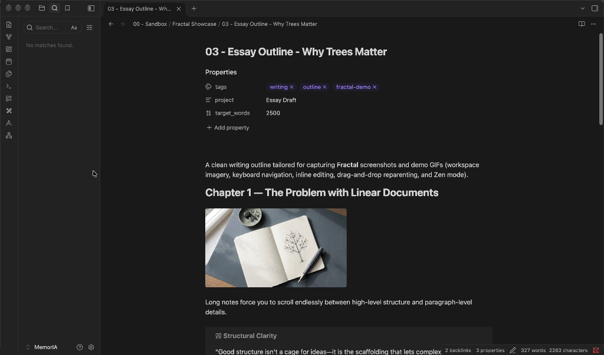

# Fractal for Obsidian

**Fractal** is an Obsidian plugin that lets you visualize and edit standard Markdown notes in a column-based card tree layout (inspired by Gingko), directly mapped to your note's Markdown heading hierarchy (`H1`–`H6`) without altering your underlying `.md` files.

## Visual Walkthrough

### Column Navigation & Inline Card Editing

Browse branches left-to-right, expand active cards, edit directly in place, and switch back to standard Markdown anytime with zero export or conversion step.

### Rich Markdown Rendering & Layout Workflow

Active cards and illuminated ancestor paths render full Obsidian Markdown (including embedded images, callouts, tables, fenced code blocks, and links), while unselected sibling cards collapse into concise previews.

## Features

- **Standard Markdown Storage:** Every card corresponds to a Markdown heading (`#` through `######`). Your notes remain 100% portable plain Markdown files.
- **Multi-Column Tree Navigation:** Browse parent sections on the left and child subsections on the right, with active-path highlighting and optional centered navigation.
- **Metadata & Introduction Panel:** Toggleable top panel showing YAML frontmatter properties and introductory text (content before the first `# H1` heading).
- **Inline Editing & Formatting Toolbar:** Double-click any card, press `Enter`, or tap the edit button in the toolbar to edit in place with formatting helpers (bold, italic, code, internal links, lists).
- **Drag & Drop Reordering:** Drag cards within a column to reorder siblings, or drop onto the center of another card or an adjacent column to reparent and auto-adjust heading levels.
- **Themes & Layout Controls:** Switch between your active **Obsidian Theme** (inheriting heading level colors `H1`–`H6`) and a **Custom** color palette (Text, Title, Canvas, Active card, Dimmed card, Aura), plus zoom, column width, inactive card height, grid overlay, and card spacing controls.
- **Per-Note Visual Organization:** Assign color accents to cards and collapse branches via the context menu.
- **Zen Mode:** Expand the Fractal canvas by collapsing Obsidian's sidebars.

## Usage

- **Ribbon Icon:** Click the **network** icon in the left ribbon to toggle between Markdown view and Fractal view.
- **Command Palette:** Run `Fractal: Toggle Fractal view`.
- **Default View Option:** Enable **Open notes in Fractal view by default** in plugin settings if desired.

### Keyboard Shortcuts (when browsing cards)

- `Arrow Up` / `Arrow Down`: Select previous/next sibling card (creates a new card at column boundaries).
- `Arrow Left` / `Arrow Right`: Navigate to parent or child column (creates a child card if none exists).
- `Enter`: Edit the selected card.
- `Escape`: Save and exit editing mode.
- `Ctrl/Cmd + C` / `Ctrl/Cmd + X` / `Ctrl/Cmd + V`: Copy, cut, or paste a card and its subtree (`Ctrl/Cmd + Shift + V` pastes as a child).
- `Ctrl/Cmd + Z` / `Ctrl/Cmd + Y` (or `Ctrl/Cmd + Shift + Z`): Undo / Redo.
- `Ctrl + N` / `Alt + N`: Insert a sibling card below.
- `Ctrl + Shift + N` / `Alt + Shift + N`: Insert a child card.
- `Ctrl/Cmd + Mouse Wheel`: Zoom in/out.

## Installation

### From Obsidian Community Plugins
1. Open **Settings → Community plugins** in Obsidian.
2. Select **Browse** and search for **Fractal**.
3. Click **Install**, then **Enable**.

### Manual Installation
1. Download `main.js`, `manifest.json`, and `styles.css` from the [latest GitHub Release](https://github.com/ide-ale/obsidian-fractal/releases/latest).
2. Place them inside `<your-vault>/.obsidian/plugins/fractal/`.
3. Reload community plugins in Obsidian settings and enable **Fractal**.

## Support

If you find Fractal useful for your writing or research, you can support ongoing development on Ko-fi:

## Author

Developed by **Alessandro Abrami** ([GitHub](https://github.com/ide-ale)).

## License

Licensed under the [MIT License](LICENSE).
