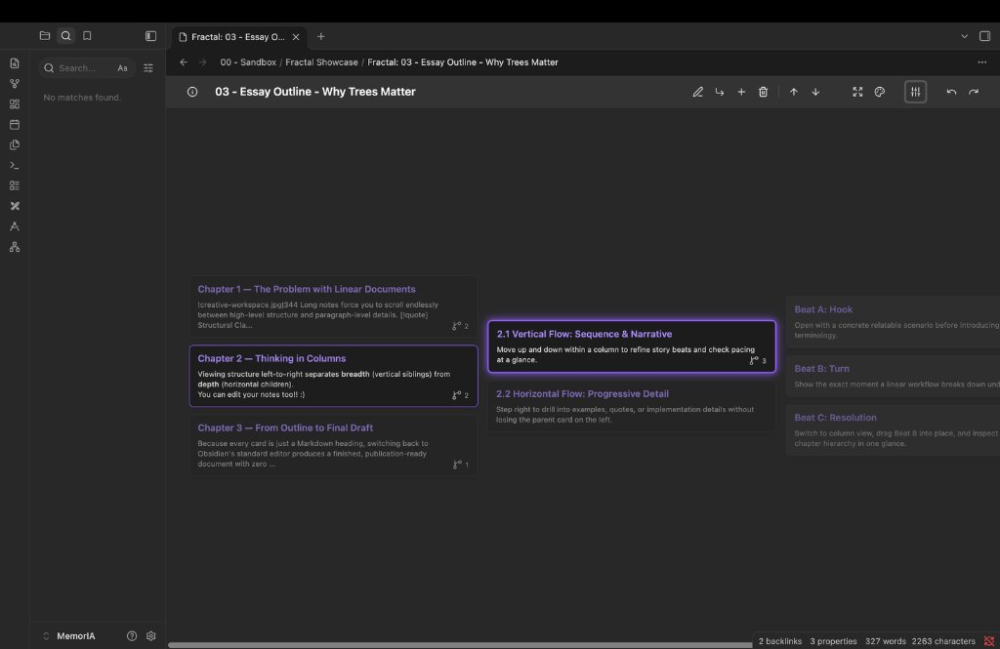
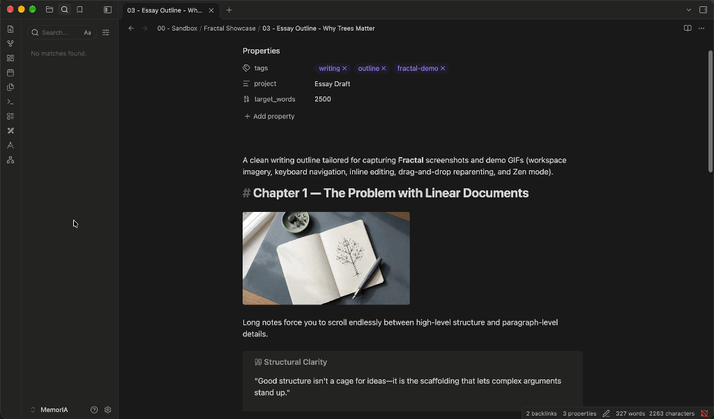
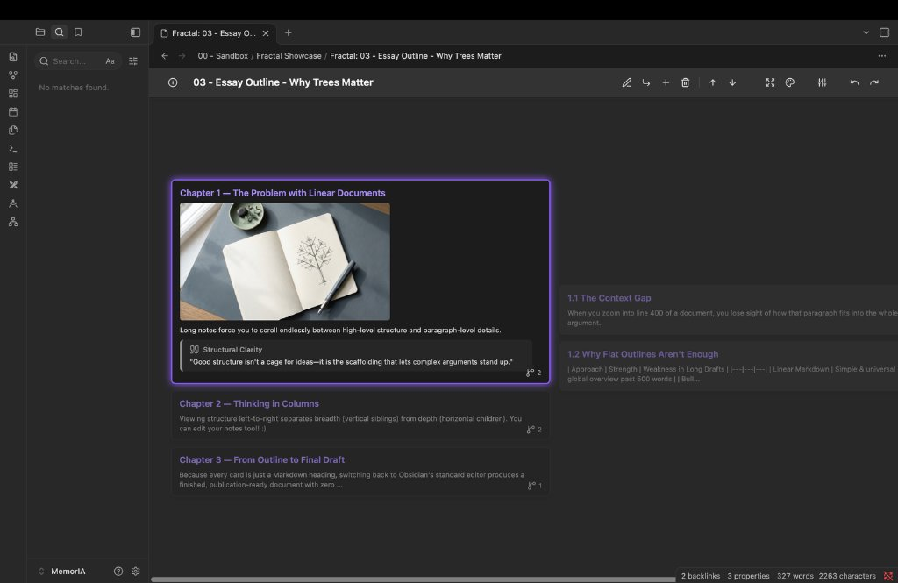

# Fractal

**Fractal** lets you visualize and edit standard Markdown notes in a column-based card tree layout (inspired by Gingko), mapped directly to your note's Markdown heading hierarchy (`#` through `######`) without modifying your underlying file format.

---

## Why Fractal?

Long Markdown documents force you to choose between keeping high-level structure in view or focusing on paragraph-level writing. Fractal turns any note's heading outline into synchronized left-to-right columns:

- **See breadth and depth together:** Parent sections stay visible on the left while subsections expand on the right.
- **Zero lock-in:** Every card *is* a standard Markdown heading section in your `.md` file. Switch freely between Obsidian's normal editor and Fractal anytime.
- **Built for desktop and mobile:** Uses only standard Obsidian and browser APIs with no Node.js or Electron dependencies.

---

## Visual Walkthrough

### Column Navigation & Inline Card Editing

Browse branches left-to-right, expand active cards, edit directly in place with Obsidian's editor, and switch back to standard Markdown at any time with zero export or conversion.

### Rich Markdown Rendering & Layout Workflow

Active cards and illuminated ancestor paths render full Obsidian Markdown—including embedded vault images, callouts, tables, fenced code blocks, and internal links—while unselected sibling cards collapse into concise previews.

---

## Features

- **Standard Markdown Storage:** Every card maps 1:1 to a Markdown heading (`#` through `######`). Your vault remains 100% portable plain Markdown.
- **Multi-Column Tree Navigation:** Illuminated ancestor paths, automatic focus scrolling, and optional centered navigation keep your active branch in clear view.
- **Properties & Introduction Panel:** Toggleable header panel for editing YAML frontmatter properties and introductory prose above the first `# H1` heading.
- **Inline Card Editing:** Double-click any card, press `Enter`, or use the toolbar edit button to edit title and body directly inside the card, complete with a quick Markdown formatting bar.
- **Drag & Drop Structuring:** Reorder sibling cards within a column, or drop onto another card or adjacent column to reparent branches and automatically adjust heading levels.
- **Themes & Visual Customization:** Inherit your active Obsidian theme (`Obsidian theme` mode with `H1`–`H6` styling) or switch to `Custom` palette colors, plus controls for zoom, column width, inactive card height, grid overlay, and spacing.
- **Per-Note Accents & Branch Folding:** Right-click cards or columns to apply color accents or collapse branches.
- **Zen Mode:** Expand the Fractal canvas across the workspace by collapsing Obsidian's sidebars.

---

## Quick Start

1. Open any Markdown note in Obsidian.
2. Click the **network** icon in the left ribbon (or open the Command Palette and run **Fractal: Toggle view**).
3. Navigate branches with the arrow keys or mouse, press `Enter` to edit a card, and press `Escape` to save and return to tree navigation.
4. Optionally enable **Open notes in Fractal view by default** in **Settings → Fractal**.

### Keyboard Shortcuts

When browsing cards in Fractal view (not actively typing inside a card editor):

| Shortcut | Action |
| :--- | :--- |
| `Arrow Up` / `Arrow Down` | Move to previous or next sibling card (creates a new card at boundaries) |
| `Arrow Left` / `Arrow Right` | Move to parent or child column (creates a child card if none exists) |
| `Enter` | Edit the selected card |
| `Escape` | Save changes and exit editing mode |
| `Ctrl + N` / `Alt + N` | Insert a sibling card below |
| `Ctrl + Shift + N` / `Alt + Shift + N` | Insert a child card |
| `Ctrl/Cmd + C` / `Ctrl/Cmd + X` / `Ctrl/Cmd + V` | Copy, cut, or paste card & subtree (`Shift + V` pastes as child) |
| `Ctrl/Cmd + Z` / `Ctrl/Cmd + Y` (or `Ctrl/Cmd + Shift + Z`) | Undo / Redo structural changes |
| `Ctrl/Cmd + Mouse Wheel` | Zoom in / out |

---

## Installation

### From Obsidian Community Plugins
1. Open **Settings → Community plugins** in Obsidian.
2. Select **Browse** and search for **Fractal**.
3. Click **Install**, then **Enable**.

### Manual Installation
1. Download `main.js`, `manifest.json`, and `styles.css` from the [latest GitHub Release](https://github.com/ide-ale/obsidian-fractal/releases/latest).
2. Copy them into `<your-vault>/.obsidian/plugins/fractal/`.
3. Reload community plugins in Obsidian settings and enable **Fractal**.

---

## Privacy & Local-First Design

- **100% offline & local:** Fractal makes **zero network requests**, collects **zero telemetry or analytics**, and sends no data outside your device.
- **Your notes stay untouched:** Structural edits update your Markdown file directly via Obsidian's Vault API, while visual preferences (theme overrides, zoom, card accents, collapsed branches) are saved locally in Obsidian's standard plugin `data.json`.

---

## Support

If Fractal helps your writing, research, or planning workflow, you can support ongoing development on Ko-fi:

## Author

Developed by **Alessandro Abrami** ([GitHub](https://github.com/ide-ale)).

## License

Licensed under the [GNU Affero General Public License v3.0 (AGPL-3.0)](LICENSE).
